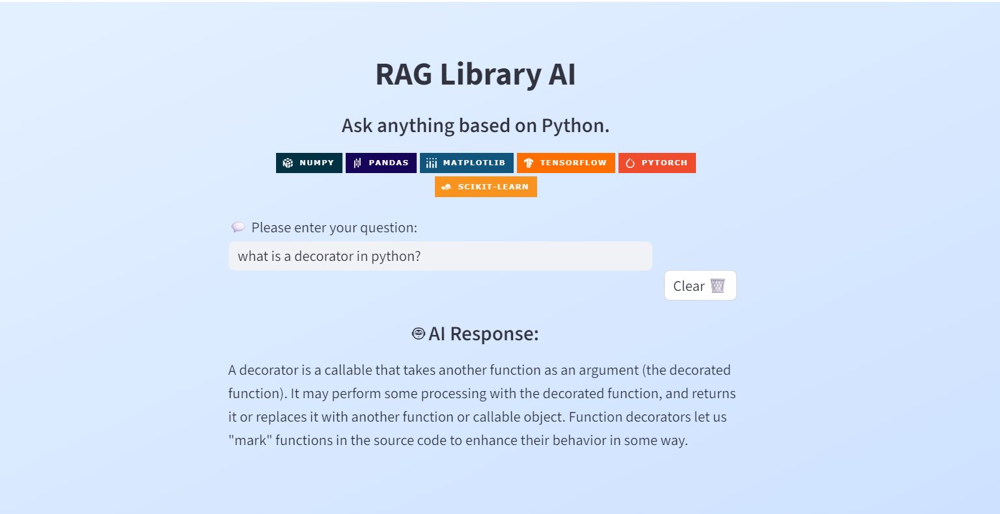
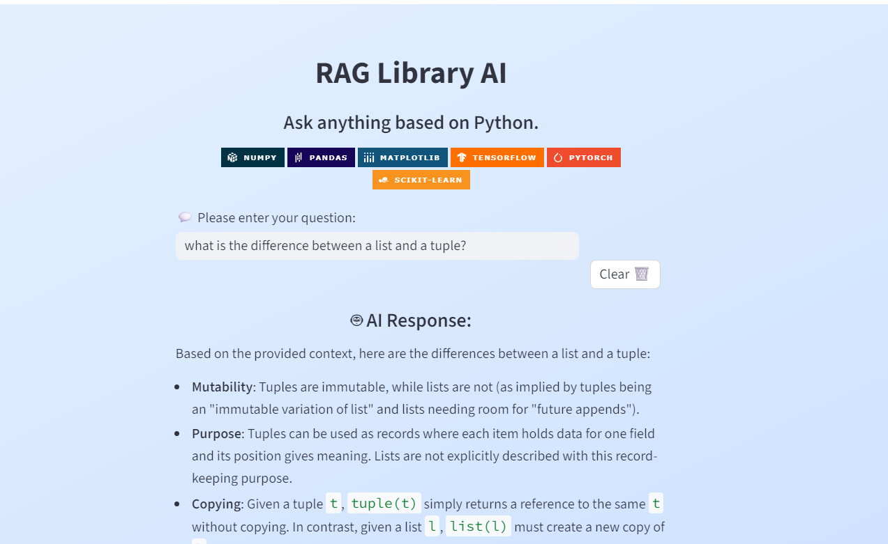

# 🏡 Rag_Library_AI


This project is a Retrieval-Augmented Generation (RAG) application designed to act as an intelligent librarian. By indexing technical Python books, it allows users to ask complex questions and receive answers grounded in the specific text of those books, complete with context.

---

## 📑 Table of Contents

| Section | Link |
|----------|----------|
| Problem | [The Problem](#-the-problem) |
| Solution | [The Solution](#-the-solution) |
| Screenshots | [Screenshots](#-screenshots) |
| Key Features | [Key Features](#-features) |
| Project Structure | [Project Structure](#-project-structure) |
| Getting Started | [Getting Started](#-getting-started) |
| Usage | [Usage](#-usage) |
| Testing | [Testing](#-pytest) |
| Hallucination Guardrail | [Hallucination Guardrail](#️-how-the-hallucination-guardrail-works) |
| Roadmap Features | [Roadmap Features](#️-roadmap) |

---

## 🚨 The Problem

Large language models can generate useful responses, but they are limited to the information available during training. This can lead to outdated, incomplete, or unverified answers when working with external knowledge sources.

## ✅ The Solution

This RAG AI Agent combines retrieval and generation to provide grounded responses using external documents and datasets. By retrieving relevant context before generation, the system helps improve accuracy, reduce hallucinations, and deliver more reliable answers.

---

## 🎯 Why This Project Exists

Many RAG systems can retrieve relevant documents but still produce incorrect, misleading, or hallucinated responses.

This project explores how retrieval systems can be combined with lightweight semantic verification techniques to improve answer reliability.

The goal was not simply to build another RAG assistant, but to investigate methods for detecting and reducing hallucinations using local embeddings and mathematical similarity checks.

---

## 📸 Screenshots

UI of the Rag Library Dashboard



---

## 🚀 Key Features
- Dual Interfaces: Interaction via a clean Streamlit Web Dashboard `(app.py)` or a lightweight CLI Tool `(query.py)`.

- Rust-Powered Performance: Document ingestion uses a custom high-speed text splitting package `(fast_chunker)` built with `Rust` and exposed to `Python` using `PyO3`.

- Semantic Guardrails: Every response undergoes a real-time Groundedness Audit using local embeddings (all-MiniLM-L6-v2) and Cosine Similarity to evaluate if the AI's response is mathematically justified by the source texts.

- Deterministic Safety Fallbacks: Completely blocks hallucinated library syntax or jumbled text blocks, gracefully bypassing checks only when the AI correctly identifies a lack of context.

---

## 📁 Project Structure
The project architecture is structured for scalability, featuring isolated scanning, processing, and documentation assembly engines.

```python
rag-technical-app/
├── fast_chunker/          # Custom Rust text splitting module
│   ├── src/
│   │   └── lib.rs         # PyO3 Rust chunking implementation
│   ├── Cargo.toml         # Rust dependency definitions
│   └── pyproject.toml     # Rust build & metadata configuration
├── vectorstore/
│   └── db/                # Persistent ChromaDB vector storage files
├── screenshots/           # Screenshots of the Rag App
├── app.py                 # Core Streamlit Web Application interface
├── query.py               # Command-line (CLI) interaction utility
├── ingest.py              # PDF Parsing and Vector Store Ingestion engine
├── guardrail.py           # Semantic Guardrail verification system
├── requirements.txt       # Python environment dependencies
├── tests/                 # Pytest suite
└── .gitignore             # Git exclusion parameters  
```

---

## 🚀 Getting Started
Prerequisites
Python 3.11 or higher

A Google Gemini API Key (obtained via Google AI Studio)

### Installation & Environment Setup
Clone the repository and move into your project root:

```Bash
git clone <https://github.com/reory/rag_library_ai>
cd rag-technical-app
```
### Create and activate a virtual environment:

```Bash
# Windows
python -m venv venv
venv\Scripts\activate

# macOS / Linux
python3 -m venv venv
source venv/bin/activate
```
### Install the project dependencies. 
This automatically installs the specialized, pre-compiled fast_chunker Linux/Windows target wheel along with core frameworks:

```Bash
uv pip install -r requirements.txt
```
### Environment Variables Configuration
- Create a .env file in the root directory to store your API credentials locally:

### Code snippet
- GOOGLE_API_KEY=your_actual_gemini_api_key_here

### Ingesting Documents
Run the ingestion pipeline to compile the high-speed Rust chunks into your persistent vector store:

```Bash
python ingest.py
```

---

## 💻 Usage
- Web Interface (Streamlit Dashboard)
Launch the responsive, styled dashboard interface locally:

```Bash
python -m streamlit run app.py
```
- Open http://localhost:8501 in your browser.

The UI features styled badge elements for core Python libraries, interactive querying, a quick history clear utility, and full audit logs mapping your Guardrail Verification parameters.

---

## 🛡️ How the Hallucination Guardrail Works
- Every response undergoes a real-time verification pipeline before reaching the interface:

- Extraction & Generation: The system retrieves the top 3 document chunks and prompts Gemini 2.5 Flash to answer using only that context.

- Semantic Auditing: A local SentenceTransformer maps both the raw context and the AI's response into dense vector arrays.

- Similarity Check: A Cosine Similarity calculation evaluates factual alignment. If the score drops below 0.62, the response is immediately blocked.

- Safe Refusal Pass: Standard phrases admitting a lack of context (e.g., "The answer isn't in the context") bypass the math filter with a perfect 1.0 score.

### ⚙️ Parameter Tuning
Adjust the strictness of the filter inside guardrail.py:
```python
class RAGGuardrail:
    def __init__(self, threshold=0.60):
``` 
- Drop to 0.55 if blocking valid text; raise to 0.65+ if hallucinations slip through 😊

---

## 🧪 Pytest
- Type in the terminal
```bash
python -m pytest
```
---

## 🛣️ Roadmap Features

- [x] High-speed Rust text chunking integration (`fast_chunker`).
- [x] Core Streamlit Web UI and CLI query processing pipelines.
- [x] Semantic Guardrail Verification (Cosine Similarity Verification).
- [ ] Source Citation
Display document names and source references alongside answers.
- [ ] Conversational Memory
Support multi-turn discussions using Streamlit session state.
- [ ] Semantic Input Routing
Reject out-of-scope questions before retrieval.
- [ ] Self-Correction Loop
Retry responses when guardrail verification fails.
- [ ] Multi-Document Knowledge Graph
Link related concepts across documents to improve retrieval.

---

* **Built by Roy Peters** 🙂
[](https://www.linkedin.com/in/roy-p-74980b382/)